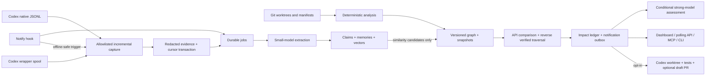

# Architecture

## Boundaries

- `domain`: stable records without provider/storage imports.
- `capture`: `Source` interface and Codex native/exec adapters. Another agent can supply discovery, identity and incremental evidence independently; Claude support does not require changing extraction or reaction.
- `repo`: deterministic Git, Go AST and npm manifest analysis. It never executes project code, dependency installers or Git external diff helpers.
- `privacy`: one redaction policy used before evidence storage, spool writes, provider requests and webhook delivery. JSON string values are redacted without corrupting encoding.
- `ai`: `Provider` interface for extraction, embeddings and impact reasoning. Disabled/local-excerpt and budgeted OpenAI Responses implementations. No provider-specific logic in the graph.
- `store`: portable SQL schema with SQLite/PostgreSQL connection adapters, normalized graph/index columns and versioned JSON records. Backend-specific logic is limited to placeholder binding, initialization, queue locking and spend locking.
- `service`: separate ingest, associate and react jobs. A capture/scan loop runs independently of the potentially slow model worker.
- `api` / `mcp` / CLI: the same service operations, rather than separate interpretations of knowledge.
- `notify` / `automation`: outbox consumers. Failure does not erase an impact or prevent context retrieval.
- `process`: timeouts, bounded output, restricted inherited secrets, and descendant process termination on Unix.

## Persistence

Tables: `projects`, `sessions`, `artifacts`, `snapshots`, `entities`, `relationships`, `claims`, `memories`, `impacts`, `jobs`, `usage_ledger`, `cache`, `automation_runs`, `named_leases`, `schema_migrations`.

Project IDs derive from canonical local paths. Remote URLs and semantically similar names are not identity proofs. A static dependency edge preserves the consumer's revision, dependency version, local/declared binding, consumed selectors and source evidence. Identical module names with no unique local binding remain ambiguous rather than merged. Historical edges are closed with `valid_to`, never deleted by rescanning.

Claims use a stable entity per `(project,key)` and immutable version IDs. A database partial unique index allows one active explicit version per key. Supersession requires optimistic concurrency against the previous version. A project can explicitly depend on a particular active version; accepting a later version closes its previous reliance edge while retaining history. Extracted claims stay proposed until explicitly recorded. Exact-key revision candidates receive expensive contradiction reasoning only when work already relies on that assertion. Model verdicts do not overwrite active facts.

Memories store the embedding model **and** dimensionality namespace, preventing incompatible vectors from being compared. Search combines cosine similarity (80%) with lexical coverage (20%). For local-scale simplicity, vectors live in the SQL database and cosine search runs in Go over the latest 10,000 memories in scope. This is exact bounded search, not an approximate-nearest-neighbor index. A pgvector/ANN adapter can replace search when corpus size warrants it; the current PostgreSQL implementation does not pretend to provide that index.

## Reliability

Transcript admission requires a registered canonical project boundary. Capture uses complete newline-terminated records, a metadata fingerprint and byte cursor; truncation or replacement restarts the source. Evidence and extraction jobs commit with cursor advancement, and competing pollers compare committed cursor state. Identical evidence/job IDs deduplicate replays. A turn's final assistant message remains evidence of what the agent said, not a verified feature or test outcome.

Repository roots are canonicalized, manifests must be regular bounded files, and resolved file paths must stay inside that root. Symlinked manifests and indexed files beneath a directory later replaced by an external symlink cannot import outside content into a snapshot.

Jobs use pending/running/done/failed states, available times, leased ownership, renewals, exponential retry and terminal failure after five attempts. A recovered lease cannot be completed by its prior owner. Deterministic impact IDs and a transactional notification outbox prevent replayed changes from creating duplicate alerts. Delivery can repeat after a crash; receivers must use `Idempotency-Key`.

Scans have a cross-process lease. One temporarily malformed/unavailable repository keeps its previous snapshot and edges while other projects continue to be processed. Capture and workers log failures and retain evidence for retry. Graph traversals stop at cycles and enforce depth/size limits. Exceeding a bound returns an error and rolls back incomplete propagation rather than silently returning a partial impact set.

Budget reservations are durable and made before requests. PostgreSQL uses an advisory transaction lock for cross-process reservation accounting. SQLite serializes writes. A timeout or malformed response retains the reservation because charging is uncertain; a cache hit spends nothing. Rate-limit/provider errors are retried by the job queue, with a fresh reservation per actual request. Prices are explicit configuration, so operators must maintain them when changing models.

## Current analysis limits

- Go API analysis parses source and reachable local function calls. It does not fully type-check arbitrary reflection, dynamic dispatch, build-tag combinations, cross-package internal call graphs, plugins or generated runtime wiring. Receiver methods reached via factories are conservative possible exposure. Dot imports and package-name mismatches can reduce API precision. Validate with real consumer tests.
- Registered projects should represent one Go module or one npm package. Register monorepo modules separately. `go.mod` local replacements and exact declared module identities are supported; `go.work` bindings are not currently resolved. Remote version pins are exposure candidates, not proof that the locally edited checkout is running in that consumer.
- npm dependencies are manifest-level, including local `file:`/`link:` references. JavaScript/TypeScript implementation edits emit possible exposure, without claiming API compatibility or confirmed breakage. Python, Rust and other language analyzers are future adapters.
- New API additions by themselves are not breaking changes. Go exported implementation changes include reachable local helpers; unrelated unconsumed APIs do not propagate. Effects of arbitrary global state or external services may require explicit assumptions.
- Only supported JSONL transcript formats are read; provider-private SQLite databases are never opened or mutated. Future Codex formats require a capture adapter update. The wrapper's own normalized spool provides a stable independent path.
- File limits are deliberate: 20,000 paths, 128 MiB of permitted text, 2 MiB per repository file, 8 MiB per transcript record, and bounded extraction batches. Repositories exceeding limits require narrower registration.
- Redaction covers configured secrets, common credential patterns, private-key blocks, email addresses and home-path prefixes. It is not a complete personal-data/DLP classifier. Explicit project disclosure consent remains essential.
- A local daemon and private SQL files are not tenant isolation. Enterprise deployment needs workspace authorization on every query, centralized project identity, worker filesystem placement, retention policies, audit controls, key management, and an ANN index. PostgreSQL is a storage option, not an automatic enterprise deployment.

These limits are surfaced as possible exposure or explicit operational errors. They should guide subsequent analyzers and evaluation fixtures rather than be hidden by model-generated certainty.
